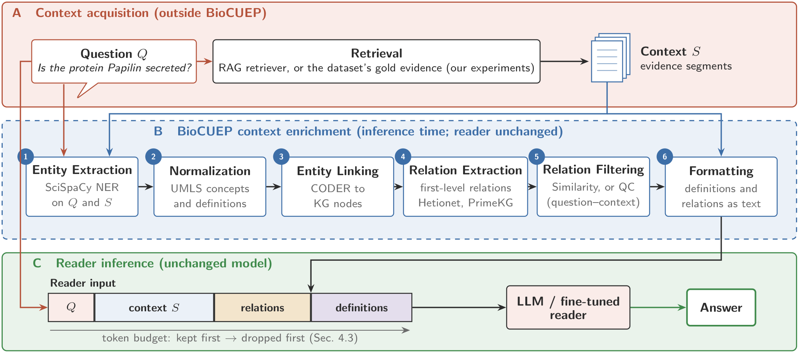

# BioCUEP: Biomedical Context Understanding Enhancement Pipeline

Official code reference and implementation for **BioCUEP** (_Biomedical Context Understanding Enhancement Pipeline_), a modular framework designed to enhance biomedical Question Answering (QA) and Retrieval-Augmented Generation (RAG) systems by integrating normalized medical concepts, definitions, and first-level relationships from Biomedical Knowledge Graphs (BKGs).

---

## 📌 Table of Contents

- [Methodology Overview](#-methodology-overview)
- [Pipeline Architecture](#-pipeline-architecture)
- [Implementation Details](#-implementation-details)
- [Data Sources & Knowledge Resources](#-data-sources--knowledge-resources)
- [Requirements & Environment Setup](#-requirements--environment-setup)
- [Configuration & Integration Settings](#-configuration--integration-settings)
- [Ablation Study Configurations](#-ablation-study-configurations)
- [How to Run & Reproduce](#-how-to-run--reproduce)
- [Repository Structure](#-repository-structure)
- [Citation](#-citation)

---

## 🧠 Methodology Overview

Biomedical QA systems frequently struggle with domain-specific terminology, ungrounded abbreviations, and latent inter-concept associations. Retrieval-Augmented Generation (RAG) typically retrieves text passages without providing structural medical context or concept-level definitions.

**BioCUEP** addresses this at inference time without requiring modifications to the downstream reader's architecture or fine-tuning process. It processes the input question $Q$ and context evidence $S$ through six modular stages:

1. **Entity Extraction**: Identifies domain entities across question and context segments using an ensemble of 4 specialized SciSpaCy NER models.
2. **Entity Normalization**: Disambiguates and normalizes entities to Unified Medical Language System (UMLS) concepts using BioBERT embeddings over local sliding context windows, retrieving official concept definitions.
3. **Entity Linking**: Maps normalized concepts to Biomedical Knowledge Graph nodes (Hetionet and PrimeKG) using dense CODER embeddings.
4. **Relation Extraction**: Queries the knowledge graphs for directly connected first-level relational triples $(h, r, t)$.
5. **Relation Filtering**: Filters noisy or tangential relations using either Entity-Link / Question-Context (QC) graph matching or TAS-B dense query similarity.
6. **Formatting & Atomic Truncation**: Converts relations and definitions into coherent natural language statements and packs them into the reader's input token budget using an atomic non-cutting truncation protocol.

---

## 🏗️ Pipeline Architecture

<p align="center">
  
  <br>
  <em>Figure 1: Overview of BioCUEP integration into the RAG architecture. (A) Context acquisition, (B) BioCUEP enrichment (inference time; reader unchanged), (C) reader inference. (Vector PDF: <a href="Figure/pipeline_overview_v2.pdf">pipeline_overview_v2.pdf</a>).</em>
</p>

---

## 🔬 Implementation Details

### Stage 1: Entity Extraction

- **NER Ensemble**: Uses 4 SciSpaCy models to maximize coverage across distinct biomedical entity classes:
  - `en_ner_craft_md` (multi-type concepts)
  - `en_ner_jnlpba_md` (genes, proteins, cell lines)
  - `en_ner_bc5cdr_md` (chemicals, diseases)
  - `en_ner_bionlp13cg_md` (anatomical, cancer, cellular entities)
- **Post-Extraction Filtering ($F$)**: Discards single-character tokens, pure punctuation/numbers, and non-biomedical mentions (`is_full_word` validation).
- **Output**: Aggregated and deduplicated entity sets $E_S$ (context) and $E_Q$ (question).

### Stage 2: Normalization & Disambiguation

- **Candidate Generation**: Matches mentions against UMLS CUIs via char-3gram approximate string matching.
- **Context-Aware Disambiguation**: Extracts a **10-word sliding window** around each entity mention in the text. Encodes the window and candidate concepts using BioBERT (`monologg/biobert_v1.1_pubmed`) and selects:
  $$c^*_e = \arg\max_{c \in C_e} \text{Sim}(e, c)$$
- **Definitions**: Extracts definitions $D_S$ and $D_Q$ for disambiguated UMLS concepts.

### Stage 3: Entity Linking to BKGs

- **Encoder**: Employs **CODER** (`GanjinZero/coder_eng`) knowledge-infused embeddings.
- **Threshold**: Concept match is retained if cosine similarity satisfies:
  $$\text{Sim}(c^*_e, b) \ge \tau \quad (\tau = 0.90)$$
- **Target Graphs**:
  - **Hetionet**: 47,031 nodes, 2.25 million edges.
  - **PrimeKG**: Precision medicine knowledge graph covering diseases, drugs, phenotypes, and pathways.

### Stage 4: Relation Extraction

- For each linked node in $L_S$ and $L_Q$, queries Neo4j or local edge tables for all directly connected 1st-level triples $(h, r, t)$.

### Stage 5: Relation Filtering

- **QC Filter (Entity-Link / Question-Context)**:
  Retains only triples where _both_ head $h$ and tail $t$ correspond to concepts found in the context or question:
  $$R_{SQ} = \{(h, r, t) \in R_S \cup R_Q \mid h, t \in L_S \cup L_Q\}$$
- **Similarity Filter**:
  Encodes question $v_Q$ and triples $v_r$ using dense retrieval encoder TAS-B (`sentence-transformers/msmarco-distilbert-base-tas-b`) and selects top-$k$ ($k=10$ per KG):
  $$R_{\text{sim}} = \text{Top-}k(R_S \cup R_Q, \text{Sim}(v_Q, v_r))$$

### Stage 6: Formatting & Atomic Truncation Protocol

- **Templates**:
  - `Relations: {source} has relations: {relation_type} with {target_node}. ...`
  - `Definitions: {concept} defined as following: {definition}. ...`
- **Atomic Non-Cutting Budget Rule**:
  - Token budget: **512 tokens** for fine-tuned readers (BioLinkBERT, GPT-2, T5) or **8192 tokens** for few-shot LLMs.
  - Retention priority: Question and original Context $S$ are **kept first** (unaltered). Relations are packed second. Definitions fill remaining space.
  - **Atomic rule**: If a relation or definition cannot fit entirely within the remaining token allowance, it is **omitted rather than cut mid-sentence**, ensuring no incomplete facts are introduced.

---

## 📊 Data Sources & Knowledge Resources

### 1. Preprocessed Experimental Benchmark Data (`Data.zip`)

The exact preprocessed benchmark data used in our experiments across all three datasets is bundled directly in **[`Data.zip`](Data.zip)** in the root directory:

- **`Data/BioASQ_Blurb/`**: BioASQ 7B Yes/No benchmark from the official BLURB benchmark (670 train, 75 dev, 140 test = 885 total questions).
- **`Data/BioASQ2024/`**: BioASQ 12B Yes/No questions released in 2024 (1,105 train, 252 dev, 102 test = 1,459 total questions).
- **`Data/PubmedQA/`**: PubMedQA BLURB official annotated split (450 train, 50 dev, 500 test = 1,000 total questions with stratified `yes`, `no`, `maybe` labels).

To unpack the preprocessed experimental data:

```bash
# On Linux / macOS / Git Bash:
unzip Data.zip

# On Windows PowerShell:
tar -xf Data.zip
```

### 2. Biomedical Knowledge Graphs (BKGs)

- **Hetionet**:
  - Official Website: [https://het.io/](https://het.io/)
  - GitHub Repository & Downloads: [https://github.com/hetio/hetionet](https://github.com/hetio/hetionet)
  - Public Neo4j Bolt Instance: `bolt://neo4j.het.io:7687` (publicly accessible read-only instance, no authentication required)
  - Reference: Himmelstein et al., _Systematic integration of biomedical knowledge prioritizes drugs for repurposing_, eLife 2017.
- **PrimeKG (Precision Medicine Knowledge Graph)**:
  - Project Portal: [https://zitniklab.hms.harvard.edu/projects/PrimeKG/](https://zitniklab.hms.harvard.edu/projects/PrimeKG/)
  - Harvard Dataverse & GitHub: [https://github.com/mims-harvard/PrimeKG](https://github.com/mims-harvard/PrimeKG)
  - Reference: Chandak et al., _Building a knowledge graph to enable precision medicine_, Scientific Data 2023.
- **UMLS (Unified Medical Language System)**:
  - Official NLM Portal: [https://www.nlm.nih.gov/research/umls/](https://www.nlm.nih.gov/research/umls/)
  - SciSpaCy UMLS Linker: [https://allenai.github.io/scispacy/](https://allenai.github.io/scispacy/)

### 3. Official Benchmark Resources

- **BLURB Benchmark (Biomedical Language Understanding & Reasoning Benchmark)**:
  - Official Portal & Leaderboard: [https://microsoft.github.io/BLURB/](https://microsoft.github.io/BLURB/)
  - Tasks Overview: [https://microsoft.github.io/BLURB/tasks.html](https://microsoft.github.io/BLURB/tasks.html)
  - BioASQ Yes/No Task: [https://microsoft.github.io/BLURB/tasks.html#bioasq](https://microsoft.github.io/BLURB/tasks.html#bioasq)
  - PubMedQA Task: [https://microsoft.github.io/BLURB/tasks.html#pubmedqa](https://microsoft.github.io/BLURB/tasks.html#pubmedqa)
- **BioASQ Challenge**:
  - Official Portal: [https://bioasq.org/](https://bioasq.org/)
  - Task 12B (2024): [https://bioasq.org/participate/challenges](https://bioasq.org/participate/challenges)
- **PubMedQA**:
  - Project Homepage: [https://pubmedqa.github.io/](https://pubmedqa.github.io/)
  - GitHub Repository: [https://github.com/pubmedqa/pubmedqa](https://github.com/pubmedqa/pubmedqa)

---

## 📦 Requirements & Environment Setup

### 1. Python Environment

Tested on Python 3.10 and 3.11 (compatible with PyTorch $\ge$ 2.0).

```bash
git clone https://github.com/your-username/Context_Understanding.git
cd Context_Understanding

pip install -r requirements.txt
```

### 2. Download SciSpaCy Pipelines

```bash
pip install https://s3-us-west-2.amazonaws.com/ai2-s2-scispacy/releases/v0.5.4/en_ner_craft_md-0.5.4.tar.gz
pip install https://s3-us-west-2.amazonaws.com/ai2-s2-scispacy/releases/v0.5.4/en_ner_jnlpba_md-0.5.4.tar.gz
pip install https://s3-us-west-2.amazonaws.com/ai2-s2-scispacy/releases/v0.5.4/en_ner_bc5cdr_md-0.5.4.tar.gz
pip install https://s3-us-west-2.amazonaws.com/ai2-s2-scispacy/releases/v0.5.4/en_ner_bionlp13cg_md-0.5.4.tar.gz
pip install https://s3-us-west-2.amazonaws.com/ai2-s2-scispacy/releases/v0.5.4/en_core_sci_scibert-0.5.4.tar.gz
```

### 3. Knowledge Graph Connectivity

By default, BioCUEP supports:

- **Hetionet Public Instance**: `bolt://neo4j.het.io:7687` (free public endpoint)
- **PrimeKG / Local Neo4j**: `bolt://localhost:7687`
- **Offline / Mock Mode**: When Neo4j is offline, BioCUEP automatically falls back to local cached dictionaries and exact/fuzzy node matching.

Configure credentials via environment variables:

```bash
export HETIONET_NEO4J_URI="bolt://neo4j.het.io:7687"
export PRIMEKG_NEO4J_URI="bolt://localhost:7687"
export PRIMEKG_NEO4J_USER="neo4j"
export PRIMEKG_NEO4J_PASSWORD="your_password"
```

---

## ⚙️ Configuration & Integration Settings

All parameters are centralized in [`biocuep/config.py`](biocuep/config.py):

| Parameter                      |        Default Value        | Description                                                      |
| ------------------------------ | :-------------------------: | ---------------------------------------------------------------- |
| `LINKING_SIMILARITY_THRESHOLD` |           `0.90`            | $\tau$: Minimum CODER cosine similarity for BKG node linking     |
| `SIMILARITY_FILTER_TOP_K`      |            `10`             | $k$: Top relations retained per KG in Similarity Filtering       |
| `NORMALIZATION_WINDOW_SIZE`    |            `10`             | Words before and after entity for BioBERT context disambiguation |
| `FINE_TUNED_READER_MAX_TOKENS` |            `512`            | Token limit for BioLinkBERT, GPT-2, and T5 reader models         |
| `LLM_READER_MAX_TOKENS`        |           `8192`            | Token budget for few-shot prompted LLMs                          |
| `DEFAULT_FEW_SHOT_TEMPERATURE` |            `0.1`            | Temperature for few-shot generative decoding                     |
| `DEFAULT_NUM_DEMONSTRATIONS`   |             `3`             | Fixed 3-shot prompt pattern control demonstrations               |
| `DEFAULT_SEEDS`                | `[7, 42, 123, 2024, 31415]` | Evaluation seeds for fine-tuned readers                          |

---

## 🧪 Ablation Study Configurations

BioCUEP defines 14 controlled configurations to isolate the contributions of definitions, relation filters, and knowledge sources:

| Exp ID     | Definitions |  Relations Filter  | Hetionet | PrimeKG | Configuration Description                  |
| ---------- | :---------: | :----------------: | :------: | :-----: | ------------------------------------------ |
| `baseline` |      –      |         –          |    –     |    –    | Unaugmented context-only baseline          |
| `exp1`     |      ✓      |         –          |    –     |    –    | PBCA: UMLS concept definitions only        |
| `exp2`     |      ✓      | Similarity (TAS-B) |    –     |    ✓    | Definitions + Similarity filter (PrimeKG)  |
| `exp3`     |      ✓      | Similarity (TAS-B) |    ✓     |    –    | Definitions + Similarity filter (Hetionet) |
| `exp4`     |      ✓      | Similarity (TAS-B) |    ✓     |    ✓    | Definitions + Similarity filter (Dual KG)  |
| `exp5`     |      ✓      |  QC (Entity-Link)  |    –     |    ✓    | Definitions + QC filter (PrimeKG)          |
| `exp6`     |      ✓      |  QC (Entity-Link)  |    ✓     |    –    | Definitions + QC filter (Hetionet)         |
| `exp7`     |      ✓      |  QC (Entity-Link)  |    ✓     |    ✓    | Definitions + QC filter (Dual KG)          |
| `exp8`     |      –      | Similarity (TAS-B) |    –     |    ✓    | Relations only (Sim + PrimeKG)             |
| `exp9`     |      –      | Similarity (TAS-B) |    ✓     |    –    | Relations only (Sim + Hetionet)            |
| `exp10`    |      –      | Similarity (TAS-B) |    ✓     |    ✓    | Relations only (Sim + Dual KG)             |
| `exp11`    |      –      |  QC (Entity-Link)  |    –     |    ✓    | Relations only (QC + PrimeKG)              |
| `exp12`    |      –      |  QC (Entity-Link)  |    ✓     |    –    | Relations only (QC + Hetionet)             |
| `exp13`    |      –      |  QC (Entity-Link)  |    ✓     |    ✓    | Relations only (QC + Dual KG)              |

---

## 🚀 How to Run & Reproduce

### 1. Run the Test Suite

Validates normalization $\arg\max$, QC filtering, similarity ranking, and atomic truncation:

```bash
python -m unittest discover tests
```

### 2. Preprocess Benchmark Datasets

Prepares Yes/No questions and gold evidence segments (already included in `Data.zip`):

```bash
# BioASQ (BLURB 7B or 12B)
python _0_Datasets_Preprocessing/format_bioasq.py --input <path_to_bioasq.json>

# PubMedQA (BLURB split: 450 train, 50 dev, 500 test)
python _0_Datasets_Preprocessing/format_pubmedqa.py --input <path_to_ori_pqal.json>
```

### 3. Execute the End-to-End Pipeline

```bash
# Run all stages on BioASQ BLURB under Exp 4 (Def + Sim + Both KGs)
python pipeline.py --stage all --dataset BioASQ_BLURB --experiment exp4

# Run under Exp 7 (Def + QC + Both KGs)
python pipeline.py --stage all --dataset BioASQ_BLURB --experiment exp7
```

### 4. Run Individual Stages

```bash
# Stage 1 & 2: Entity Extraction & Normalization
python pipeline.py --stage 1 --dataset BioASQ_BLURB

# Stage 3: Entity Linking (tau = 0.90)
python pipeline.py --stage 3 --dataset BioASQ_BLURB

# Stage 4: Relation Extraction
python pipeline.py --stage 4 --dataset BioASQ_BLURB

# Stage 5: Relation Filtering (QC & Similarity)
python pipeline.py --stage 5 --dataset BioASQ_BLURB

# Stage 6: Formatting & Atomic Truncation
python pipeline.py --stage 6 --dataset BioASQ_BLURB --experiment exp4
```

### 5. Run Baseline Relation Filters

```bash
# Random Relation Integration (RRI, k=10)
python _Baselines_Relation_Filters/_1_Random_Relation_Addition.py

# Top-N Frequency (N=10)
python _Baselines_Relation_Filters/_2_top_n_relation_frequency.py

# Cluster-based Selection (KMeans k=10)
python _Baselines_Relation_Filters/_4_cluster_based.py

# TF-IDF Weighted Relations (TF-IDF-RI)
python _Baselines_Relation_Filters/_5_tfidf_weighted_relations.py

# Dense Retrieval Ranking
python _Baselines_Relation_Filters/_6_Dense_Retrieval_for_Relation_Ranking.py
```

### 6. Evaluation & Metrics Reporting

```bash
# Display intrinsic stage metrics summary (Table 5)
python evaluate_readers.py --intrinsic

# Display baseline relation support summary (Table 6)
python evaluate_readers.py --baselines

# Display reader benchmark summary (Table 7)
python evaluate_readers.py --results
```

---

## 📁 Repository Structure

```
Context_Understanding/
├── biocuep/                            # Core BioCUEP Python Package
│   ├── __init__.py                     # Package entrypoint & version
│   ├── config.py                       # Central configuration (tau=0.90, k=10, 512 tokens)
│   ├── extraction.py                   # Stage 1: 4 SciSpaCy NER models + filter F
│   ├── normalization.py                # Stage 2: UMLS match + BioBERT 10-word sliding window argmax
│   ├── linking.py                      # Stage 3: CODER embedding BKG linking (tau=0.90)
│   ├── relations.py                    # Stage 4: 1st-level relation extraction from BKGs
│   ├── filtering.py                    # Stage 5: QC Filter (Eq. 7) & TAS-B Similarity Filter (Eq. 8)
│   ├── formatting.py                   # Stage 6: Template formatting & atomic non-cutting truncation
│   ├── baselines.py                    # 6 Baselines: RRI, Top-N, Cluster-based, TF-IDF-RI, CoT, PBCA
│   ├── experiments.py                  # Table 2: 14 Ablation configurations generator
│   ├── readers.py                      # Downstream readers: BioLinkBERT classification & few-shot LLMs
│   ├── evaluation.py                   # Intrinsic evaluation (Table 5) & error correlation
│   ├── pipeline.py                     # High-level BioCUEPPipeline orchestrator
│   └── utils.py                        # Safe logging, tqdm shim, JSON I/O
│
├── Figure/                             # Architecture figures
│   ├── pipeline_overview_v2.pdf        # Vector graphic PDF of the pipeline overview
│   └── pipeline_overview_v2.png        # High-resolution raster rendering for web display
│
├── Data.zip                            # Preprocessed benchmark datasets bundle (BLURB splits)
├── Data/                               # Extracted preprocessed data (BioASQ_Blurb, BioASQ2024, PubmedQA)
├── _0_Datasets_Preprocessing/          # Dataset formatting utilities
├── _1_Entities_Extraction_Normalization/ # Stage 1 & 2 executable runner
├── _2_Entities_Linking/                # Stage 3 executable runner
├── _3_Relations_Extraction/            # Stage 4 executable runner
├── _4_Filtering_Relations/             # Stage 5 executable runner (QC & Sim filters)
├── _5_Relevant_Text_Explanations_Formatting/ # Stage 6 executable runner
├── _Baselines_Relation_Filters/        # Baseline relation selection scripts
│
├── data/
│   └── sample_fig2.json                # BioASQ-BLURB test sample
├── tests/                              # Comprehensive unit and integration test suite
├── config_file.py                      # Root path configuration
├── pipeline.py                         # Unified CLI pipeline runner
├── demo.py                             # Standalone interactive walkthrough
├── evaluate_readers.py                 # Benchmark & evaluation metrics reporter
└── requirements.txt                    # Python dependencies
```

---

## 📜 Citation

If you use BioCUEP in your research, please cite our paper:

```bibtex
@article{biocuep2026jcst,
  title   = {Enhancing Biomedical Context Understanding in Language Models using Medical Knowledge Graphs: Application to Question Answering Systems},
  author  = {Anonymous Authors},
  journal = {Journal of Computer Science and Technology},
  year    = {2026},
  url     = {https://anonymous.4open.science/r/Context_Understanding-08E0/}
}
```
